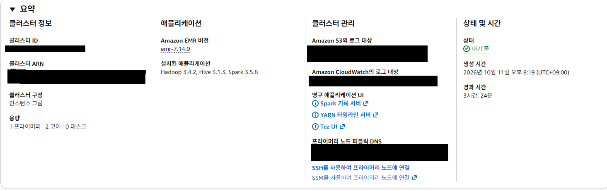
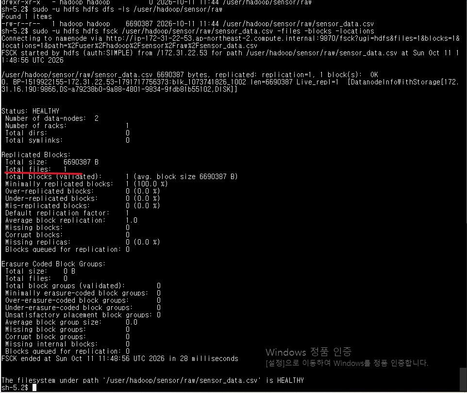
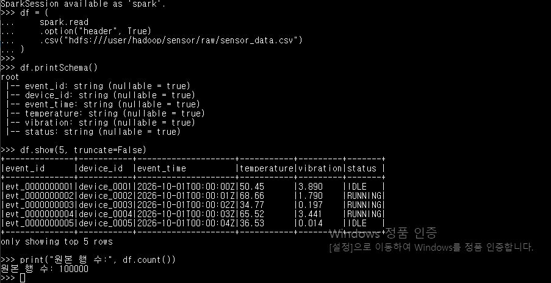
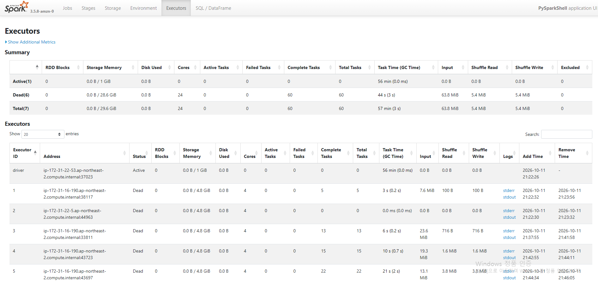
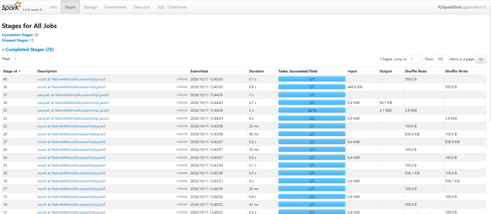
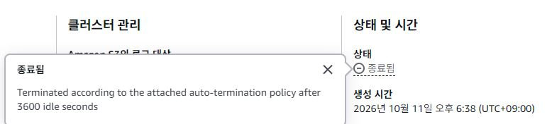

# Sensor Data Pipeline

AWS EMR에서 Hadoop·Spark·Hive를 익히기 위한 가상 센서 데이터 프로젝트입니다.
HDFS에 저장된 데이터를 정제하고 정합성, 재처리, 장애 복구,
처리 성능을 검증하는 것이 목표입니다. 실제 설비 데이터가 아닌 합성 데이터를 사용합니다.

## 테스트 데이터 생성기 사용 방법

Python 3.10 이상을 사용합니다.
Windows는 `python3` 대신 `python`을 사용해도 됩니다.

```bash
python3 src/generator/generate_sensor_data.py
python3 -m unittest discover -s tests -v
```

기본 출력 위치는 `data/generated/run-001/`입니다. 
기존 결과를 덮어쓰지 않으므로 재실행할 때는 새 출력 경로를 지정하세요.

```bash
python3 src/generator/generate_sensor_data.py --rows 100000 --devices 100 --seed 42 --output-dir data/generated/run-002
```

| 출력 파일 | 용도 |
|---|---|
| `sensor_data.csv` | 이후 HDFS에 업로드할 원본 데이터 |
| `injections.csv` | 오류·중복·유효한 고온 측정값의 행 번호, ID, 변경값 |
| `manifest.json` | 생성 조건, 예상 정제 결과, 파일 크기, SHA-256 |

## 생성 데이터

`--rows`는 **중복까지 포함한 최종 CSV 행 수**입니다.

| 항목 | 기본 100,000행 기준 |
|---|---:|
| 원본 행 수 | 100,000 |
| 고유 event_id | 99,000 |
| device_id 결측 | 1,000 |
| event_time 형식 오류 | 1,000 |
| temperature 숫자 형식 오류 | 1,000 |
| 정상 이벤트의 완전 중복 | 1,000 |
| 유효한 고온 측정값 (120°C, ALARM) | 1,000 |
| 오류 격리 후 중복 제거한 결과 | 96,000 |

**100,000 = 격리 3,000 + 제거한 중복 1,000 + 정제 결과 96,000**입니다.
고온 1,000건은 정제 결과에 포함됩니다. 수치가 높다는 이유로 삭제하지 않았습니다.

## 실습
### 1. 실습 세팅
EMR 클러스터 세팅 (프라이머리 1, 코어 2, 태스크 0)


클러스터 상태가 ‘대기 중(Waiting)’이면 초기 프로비저닝과 선택한 애플리케이션 설치·구성이 완료됐단 뜻이다.



아래는 hdfs로 생성된 데이터를 hdfs로 올리는 작업이다.
SSM으로 연결후 **셸(`sh-5.2$`)**에서 실행했다. `/tmp/sensor_data.csv`로 데이터를 옮겨둔 상태이다. 원본은 PC에서 생성하고 S3를 거쳐 Primary로 복사했다.
```bash
sudo -u hdfs hdfs dfs -mkdir -p /user/hadoop/sensor/raw
sudo -u hdfs hdfs dfs -chown -R hadoop:hadoop /user/hadoop/sensor
sudo -u hadoop hdfs dfs -put /tmp/sensor_data.csv /user/hadoop/sensor/raw/

sudo -u hadoop hdfs dfs -ls -h /user/hadoop/sensor/raw/
sudo -u hdfs hdfs fsck /user/hadoop/sensor/raw/sensor_data.csv -files -blocks -locations
```



파일 크기가 약 6.7MB로 블록 크기보다 작아 하나의 블록으로 저장됐으며, 복제 계수가 1이므로 두 Core 노드 중 한 곳에만 저장된걸 확인할수 있다.

### 2. PySpark 입력 확인

```bash
sudo -u hadoop -H pyspark --master yarn --deploy-mode client
```

이후 **Python 프롬프트(`>>>`)**에서 실행한다. 아래 코드는 대화형 실습 내용을 정리했다.

```python
from pyspark.sql import functions as F

spark.conf.set("spark.sql.session.timeZone", "UTC")
df = (
    spark.read
    .option("header", True)
    .csv("hdfs:///user/hadoop/sensor/raw/sensor_data.csv")
)
df.printSchema()
df.show(5, truncate=False)
print("원본 행 수:", df.count())
```


### 3. 오류 격리

```python
checked = (
    df
    .withColumn("event_time_ts", F.try_to_timestamp("event_time"))
    .withColumn("temperature_num", F.expr("try_cast(temperature as double)"))
)
checked = checked.withColumn(
    "error_reason",
    F.concat_ws(
        ",",
        F.when(
            F.col("device_id").isNull() | (F.trim(F.col("device_id")) == ""),
            "missing_device_id"
        ),
        F.when(F.col("event_time_ts").isNull(), "invalid_event_time"),
        F.when(F.col("temperature_num").isNull(), "invalid_temperature")
    )
)
quarantine = checked.filter(F.col("error_reason") != "")
valid = checked.filter(F.col("error_reason") == "")

quarantine.groupBy("error_reason").count().show(truncate=False)
print("오류 격리:", quarantine.count())
print("오류 제외:", valid.count())
```

### 4. 중복 제거·Parquet 저장

Spark UI에서 `parquet` 작업의 Stage 완료는 확인했다. 다만 이 목록만으로 각 출력 경로와 최종 행 수를 확정할 수 없으므로, 아래 중복 제거 수치와 저장 결과 재읽기 출력은 추가 검증 대상으로 남긴다.

```python
clean = valid.dropDuplicates(["event_id"])
print("최종 정제:", clean.count())
print("제거한 중복:", valid.count() - clean.count())
print("유효한 고온 데이터:", clean.filter(
    (F.col("temperature_num") == 120) & (F.col("status") == "ALARM")
).count())

clean_output = clean.select(
    "event_id", "device_id",
    F.col("event_time_ts").alias("event_time"),
    F.col("temperature_num").alias("temperature"),
    F.col("vibration").cast("double").alias("vibration"),
    "status"
)
clean_output.write.mode("errorifexists").parquet(
    "hdfs:///user/hadoop/sensor/processed/run-001"
)
quarantine.write.mode("errorifexists").parquet(
    "hdfs:///user/hadoop/sensor/quarantine/run-001"
)
```

### 5. 저장 결과 검증

`>>>`에서 실행한다. HDFS 저장이 완료된 경우에만 실행한다.

```python
saved = spark.read.parquet("hdfs:///user/hadoop/sensor/processed/run-001")
saved_bad = spark.read.parquet("hdfs:///user/hadoop/sensor/quarantine/run-001")
print("정제 저장 행 수:", saved.count())
print("고유 event_id:", saved.select("event_id").distinct().count())
print("격리 저장 행 수:", saved_bad.count())
print("고온 보존:", saved.filter(
    (F.col("temperature") == 120) & (F.col("status") == "ALARM")
).count())
saved_bad.groupBy("error_reason").count().show(truncate=False)
saved.printSchema()
```

### 6. spark 기록 ui 확인

PySpark 실습 중 생성된 Executor의 작업 수행 내역을 확인했다. 전체 Task 60개가 완료됐으며 실패한 Task는 0개였다. 캡처 시점에는 Driver만 Active 상태였고, Executor 6개는 Dead 상태로 표시됐다. 이는 현재 실행 중이 아니라는 의미이며, 작업 실패 여부와는 구분된다.


데이터 건수 조회(count)와 Parquet 저장 과정에서 실행된 Stage를 확인했다. 총 28개 Stage가 완료됐으며, 각 단계의 Task 성공 수, 실행 시간, 데이터 입출력량을 확인할 수 있었다. 일부 단계에서는 Shuffle Read·Write가 발생해 처리 과정에서 데이터 재분배가 수행됐음을 확인했다.

### 7. 문제와 해결 과정

1. 클러스터 자동 종료
실습 중 클러스터가 갑자기 종료되었다. 종료 사유를 확인하니 유휴 상태가 3,600초 지속되면 자동 종료하는 정책이 적용되어 있었다.

터미널에 접속해 있어도 EMR이 유휴 상태로 판단할 수 있다는 것을 알게 되었고, 이후 클러스터 생성 시 종료 옵션을 수동 종료로 변경했다.


2. PySpark 일시 중지로 인한 프로세스 중복 실행
PySpark에서 Ctrl+Z를 누른 뒤 다시 실행하자 4040·4041 포트가 사용 중이라는 경고가 발생했다. jobs -l로 확인한 결과, 기존 PySpark 작업 2개가 종료되지 않고 Stopped 상태로 남아 있었다. fg %1, fg %2로 각 작업을 불러온 뒤 exit()로 종료하고 다시 실행해 원본 10만 행을 정상적으로 조회했다. Ctrl+Z는 종료가 아닌 일시 중지이며, 정상 종료할 때는  exit()을 사용해야 한다.


## 폴더 안내

| 경로 | 역할 / 상태 |
|---|---|
| `src/generator/` | 센서 데이터 생성기 |

